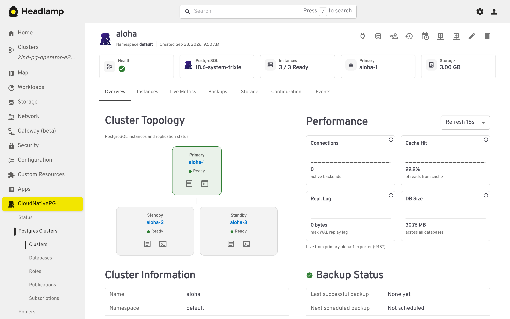
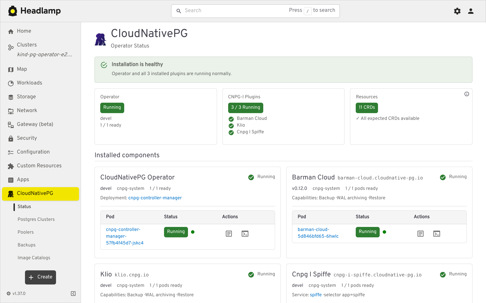
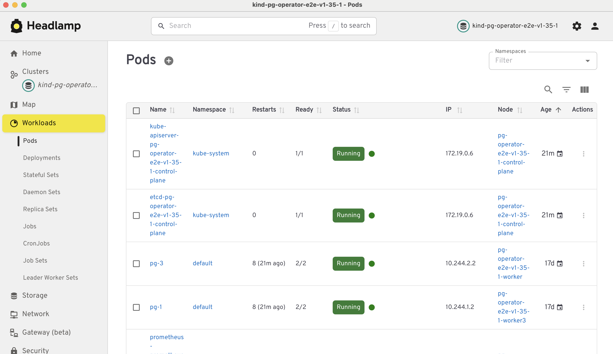

TL;DR: The [CNPG Headlamp Plugin](https://github.com/cloudnative-pg/cnpg-headlamp-plugin) has been released. You can install it today from the official [Headlamp plugin catalog](https://headlamp.dev/docs/latest/installation/desktop/plugins-install-desktop/).

What started as a small experiment in my spare time is now a [CloudNativePG community](https://github.com/cloudnative-pg) project.

This is the story of how the CNPG Headlamp Plugin came to be, and why I think having a UI for CloudNativePG can be useful.

## It started with a conversation

I first heard about Headlamp at the office. Some of the CloudNativePG maintainers were talking about it after coming back from the conference *KubeCon + CloudNativeCon Europe 2026*. I didn't know much about Headlamp at the time, but the idea immediately caught my attention.

I was looking for a Kubernetes UI for my own work, so I started wondering:

**How hard would it be to build a UI for CloudNativePG using Headlamp?**

There was only one way to find out. In my spare time, I started playing with [Headlamp](https://headlamp.dev) and its [plugin system](https://headlamp.dev/docs/latest/tutorials/plugin-development/). At first, I just wanted to understand how it worked. Then I started adding CloudNativePG resources.

A cluster view here. Some actions there. A few more resources.

And, little by little, it started to become something I could actually use.

That's when I started thinking that maybe it could be useful for other people too.

## Let's see what the community thinks

Rather than keeping the project as a personal experiment, I decided to show it to the CloudNativePG community. I presented it during a [CNPG community](https://github.com/cloudnative-pg#cloudnativepg-community-meetings) [meeting](https://notes.cncf.io/IKJxyuSsQnWkIqu7DnjFaA#August-13-2026-79) to get some feedback and, more importantly, to understand whether there was real interest in having a CloudNativePG plugin for Headlamp.

The response was very positive.

During the meeting, I proposed donating the project to the CloudNativePG community. The maintainers then spent some time evaluating and studying it, and the donation was approved in an [official vote](https://github.com/cloudnative-pg/governance/issues/76). That was a really exciting moment.

What had started as something I was doing in my free time had become a community project.

A big thank you to all the contributors who helped from the very start - with ideas, feedback, fixes, new features, and work on CI.

## Why Headlamp?

For those who haven't used it yet, [Headlamp](https://headlamp.dev/) is a Kubernetes UI.

I chose it because it is an official CNCF project, developed under the Kubernetes SIG UI initiative. This means it is open source, vendor neutral, and a natural home for a project like CloudNativePG, which is also part of the CNCF.

Another reason is its plugin system. It allows projects like CloudNativePG to add their own views and actions while still being part of the same Kubernetes interface. This means that you can use Headlamp to work with Kubernetes and, at the same time, get a UI specifically designed for CloudNativePG.

And that is really the main idea behind the plugin. It is not meant to replace `kubectl` or the [CloudNativePG CLI](https://cloudnative-pg.io/docs/devel/kubectl-plugin). Sometimes the command line is exactly what you want.

But sometimes you just want to open a page, look at your cluster, understand what is happening, and click on the operation you need. That's where a UI can help.

## What can you do with it?

The plugin is growing quite quickly, and there are already several things you can do with it.

You can explore your CloudNativePG clusters, inspect their instances, look at PostgreSQL logs, open a `psql` terminal, check live metrics, manage backups, and perform some common operations directly from the UI.

There is also support for resources such as Poolers, Object Stores, Databases, Database Roles, Publications, Subscriptions, and Image Catalogs.

## How to install it

The plugin is an official Headlamp plugin and it is published on [Artifact Hub](https://artifacthub.io/packages/headlamp/cnpg-headlamp-plugin/cnpg-headlamp-plugin).

This means you don't need to build anything. If you use Headlamp Desktop, open the [Plugin Catalog](https://headlamp.dev/docs/latest/installation/desktop/plugins-install-desktop), search for `cnpg`, and click install.

If you run Headlamp inside your cluster, follow the [plugin management section](https://headlamp.dev/docs/latest/installation/in-cluster/#plugin-management) of the Headlamp documentation to add the plugin to your deployment.

Once it is installed, CloudNativePG will appear in the Headlamp sidebar.

## There is still a lot to do

The project is still evolving. There are more CloudNativePG resources to support, more operations that could be exposed through the UI, and, of course, plenty of things that can be improved.

The plugin started with a simple question I had for myself:

**"Could I build a CloudNativePG UI with Headlamp?"**

Now the more interesting question is:

**"What can we build together?"**

If you are using CloudNativePG and Headlamp, give the plugin a try. If you find something that doesn't work well, have an idea for a new feature, or simply have an opinion about how the UI should work, let us know.

This project started with a conversation I happened to overhear at the office. I'm very curious to see where the next conversation will take it.
