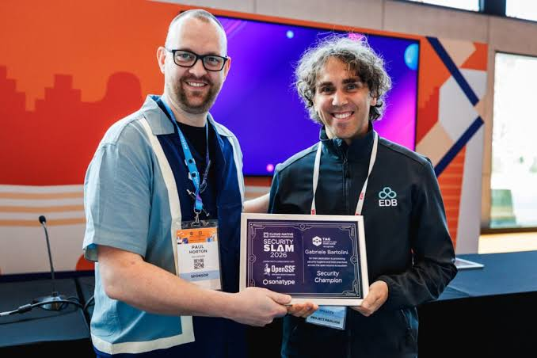

The 2026 Fall [SecuritySlam](https://securityslam.com/) has concluded. Run by the CNCF Technical Advisory Group for Security & Compliance, the Slam is a month-long community effort with a library of support resources, advisors on Slack, and plaques and badges for participating projects and contributors.

I was the [Security Champion for the CloudNativePG project](https://securityslam.com/outcomes/fall-2026/cloudnativepg) this time around. It was my first time as a SecuritySlam contributor, end-responsible for the objectives. The 2026 Spring SecuritySlam culminated at KubeCon + CloudNativeCon Europe in March, in Amsterdam, where we were recognized for the "exemplary measures taken to demonstrate project security", and Gabriele Bartolini got awarded as a Security Champion. 

CloudNativePG already had gained three out of six badges before the start of the Slam: Cleaner, Inspector, and Mechanizer. Now we also earned the remaining three.

### Chronicler 
While Documentation might not feel like security work, good security practice is always preceded by good documentation. The requirements for the badge were to write user guides, a defect and vulnerability reporting process, governance, and a description of how releases are built and published, and to reference them from the security insights file. 

**Our work:** there were some missing elements and typo to fix inside the `security-insight.yml`.

### 2 Defender  
For this badge you need to reach a passing OSPS Baseline status for your project's maturity level, with the result published where anyone can check it. Public. Verifiable.

**Our work:** there was a small adjustment needed to make on the default permissions for GitHub Actions.

### CRA-Readiness 
This is an all-new badge introduced this fall's Slam. To earn it, you need to implement the CRA guidelines provided by your project's steward.
 
We claimed it by adding the required redirection to the already present information for vulnerability reporting, and specifying the Linux Foundation as the open source steward for CloudNativePG. 

We made good use of the AI tool provided by the CNCF's Security Committee Team to check the current security status of the project. This tool reports any issue and suggests fixes. The Security Committee Team was really helpful in explaining the entire process on the website and in the [video Eddie Knight published](https://www.youtube.com/watch?v=AvjltBoM4rE). And it was a team effort, I wouldn’t have been able to finish in time without the help of Gabriele Bartolini.

This was the first time the Slam was open to any open source project - you didn't need to be a CNCF project, or even do cloud native "stuff". The pgBouncer project also took part, EDB-colleague Peter Eisentraut took part as the project’s Security Champion. 

## What’s next?

I hope the Slam continues to stay open for all open source projects to encourage more maintainers to invest in improving their security posture. Likely the next Slam will be organized to wrap up with the start of KubeCon + CloudNativeCon EU 2027, in Barcelona. 
